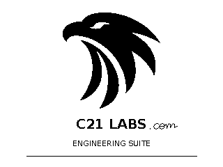
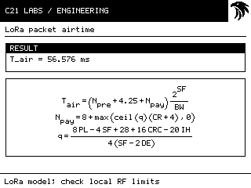
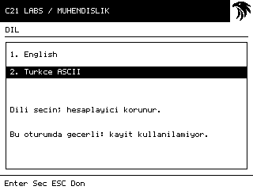

# C21 Engineering Suite

## Version 1.0.3

**Engineering knowledge. Anywhere. Offline.**

C21 Engineering Suite is an independent, offline engineering calculation and reference application developed by C21 LABS for the original monochrome TI-Nspire Touchpad. Designed for students, engineers, electronics enthusiasts and RF experimenters, it combines interactive mathematical tools with a practical engineering handbook.

[Download the native .tns](https://github.com/ihsanburak/c21-engineering-suite/releases/download/v1.0.3/C21_Engineering_Suite_v1.0.3.tns) · [Release and source packages](https://github.com/ihsanburak/c21-engineering-suite/releases/tag/v1.0.3) · [Checksums](https://github.com/ihsanburak/c21-engineering-suite/releases/download/v1.0.3/SHA256SUMS.txt) · [C21 LABS website](https://c21labs.com)

### What changed in 1.0.3

Animated Eagle opening screen with a handwritten `.com` suffix; the final frame stays until input. Enter / Touchpad center-click can skip to the menu. [All changes](CHANGELOG.md).

### Features

- **138 interactive targets across 64 documented engineering families**, including one formatting utility
- RF power, impedance, wireless link budgets, antenna propagation and Fresnel zones
- LoRa modulation, coding relationships, packet airtime, budgets and transmission-energy estimates
- RLC circuits, resonance, electronics, filters, electrical power and battery estimates
- PCB traces/microstrip, component calculations, VNA measurements, VSWR, return loss and S-parameters from manually entered data
- Editable numeric inputs, engineering units, visual mathematical formulas and Formula/List modes
- Contextual technical Handbook with symbol definitions, laboratory usage, assumptions, worked examples and common mistakes
- **English / Turkce ASCII**, English default, and fully offline operation

These are actual **320×240 application framebuffer renders from the Windows host preview**, not device photographs. Existing C21 Eagle application artwork is unchanged. Master SVG/transparent PNG files are not yet supplied; no new promotional logo or replacement artwork was made.

### Hardware and installation

**Original TI-Nspire Touchpad, non-CAS**, monochrome320×240, **OS3.9.0.463**, with already-working compatible **Ndless**. CAS, CX/CXII and other OS/hardware combinations are not verified targets. This is a genuine native ARM/Ndless .tns, not a TI-Basic document.

Verify the release SHA-256, preserve your prior version, and transfer the .tns using your existing document-transfer setup. Open it under existing Ndless. No firmware reset/update or Ndless reinstall is required. [Installation](docs/INSTALL.md) · [English quick start](docs/QUICKSTART_EN.md) · [Türkçe hızlı başlangıç](docs/QUICKSTART_TR.md).

Digits select numbered entries (**0=10**); arrows navigate; keyboard Enter/Touchpad center-click confirm; Esc returns. C calculates, F switches Formula/List, O chooses supported outputs, U selects units and H opens the contextual Handbook. S → Language offers **1. English**, **2. Turkce ASCII**. Values, units and valid result state survive language switching.

### Categories

1. RF CALCULATOR
2. BASIC ELECTRONICS
3. RLC & IMPEDANCE
4. POWER & BATTERY
5. FILTER DESIGN
6. PCB ENGINEERING
7. ANTENNA & PROPAGATION
8. MEASUREMENT LAB
9. ENGINEERING TOOLS
10. ENGINEERING HANDBOOK

[Coverage summary](docs/COVERAGE.md) · [Full target inventory](docs/CALCULATION_INVENTORY.md). Alternate solved variables are targets, not independently counted physical families; shared menu links do not duplicate mathematical functions.

### Validation and limitations

Application **1.0.3** is **628,560 bytes**, SHA-256 `61730cf61148e830245a9e7948187053985d92f19d20e9ed9b68abd5d6b36006`. Fresh Windows and GCC ASan/UBSan results are recorded in [validation](docs/VALIDATION.md). These tests do not establish correctness for every real input or physical-model validity.

The owner reports launch on a real classic Touchpad and three passed owner-assisted numerical examples: **LC resonance, Ohm's law and mW-to-dBm**. Physical execution and animation timing of 1.0.3 remain unverified; earlier owner-reported checks apply to earlier builds. **Every calculation has not been physically verified; this is not hardware certification.**

Read [validation](docs/VALIDATION.md), [known limitations](docs/KNOWN_LIMITATIONS.md), [technical specifications](docs/TECHNICAL_SPECIFICATIONS.md) and [release notes](RELEASE_NOTES.md). Microstrip uses a zero-thickness model; trace-current estimates are advisory; statistics use four normalized readings; SMD decoding is numeric-only. LoRa targets legacy SX127x SF7–12 and125/250/500kHz; nominal bit rate differs from application throughput. No regulatory compliance, component safety rating, or real instrument/radio integration is promised.

### Engineering philosophy

Engineering knowledge should remain accessible on compact, standalone hardware without relying on internet connectivity or external services. Every tool combines results with practical context, documented assumptions and laboratory guidance.

### Development, credits and licensing

Original C21-owned code is [MIT licensed](LICENSE), with [scope and exclusions](LICENSE_SCOPE.md). The Eagle is separately identified [brand artwork](media/ARTWORK_RIGHTS.md). nSDL/SDL, Ndless, Newlib and GCC runtime retain their licenses: [notices](THIRD_PARTY_NOTICES.md), [included source/relink materials](third_party/REDISTRIBUTION.md). No blanket MIT relicense of third parties is implied.

[Build](docs/BUILD.md) · [Contributing](CONTRIBUTING.md) · [Release](https://github.com/ihsanburak/c21-engineering-suite/releases/tag/v1.0.3). Pinned upstream source, license copies and C21 ARM objects accompany the release/source package for redistribution/relinking obligations. Development tools and firmware are not bundled.

**Developed by C21 LABS — From physical engineering to digital intelligence.**

Independent project. **Not affiliated with, sponsored by or endorsed by Texas Instruments or the Ndless project.** TI-Nspire is a Texas Instruments trademark; dependency names identify components, not endorsements. No TI firmware or private boot images are distributed.
