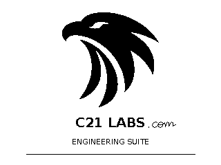

# C21 Engineering Suite 1.0.3

Released 2026-11-12. Update from application 1.0.2 / Version 1.0 Classic Edition.

## Changes / Degisiklikler

- Animated Eagle startup: 56 monochrome frames at a requested 50 ms frame delay. Original logo pixels arrive from below, followed by a handwritten `.com` suffix.
- The final opening screen stays visible until input; Enter or Touchpad center-click continues to the menu. Input can skip the animation.
- Settings now displays application version **1.0.3**. Calculation engines, 138 targets and English / Turkce ASCII support are retained.
- Added animation regression coverage and updated native input-loop tests, build scripts and relink objects.

Turkce: Eagle acilis animasyonu ve el yazisi `.com` eki eklendi. Son kare tus girisine kadar kalir; Enter veya orta tik ile menuye gecilir. Hesaplama motorlari korunmustur.

## Opening screen / Acilis ekrani

Actual 320x240 C framebuffer host previews; these are not calculator photographs. Physical animation timing and device execution of 1.0.3 remain unverified.

## Download and verification

Native ARM/Ndless executable: `C21_Engineering_Suite_v1.0.3.tns`, **628,560 bytes**.

SHA-256: `61730cf61148e830245a9e7948187053985d92f19d20e9ed9b68abd5d6b36006`.

Original TI-Nspire Touchpad non-CAS, OS 3.9.0.463, existing compatible Ndless. Preserve your previous executable before transferring the update. No firmware change is included.

**569,912 checks passed per platform**, Windows and GCC ASan/UBSan (13 suites). Test results are recorded in [validation](docs/VALIDATION.md). Source archives include dependency source, notices and all 13 application ARM objects for relinking. Original C21 code is MIT; artwork and dependencies retain separate terms.
